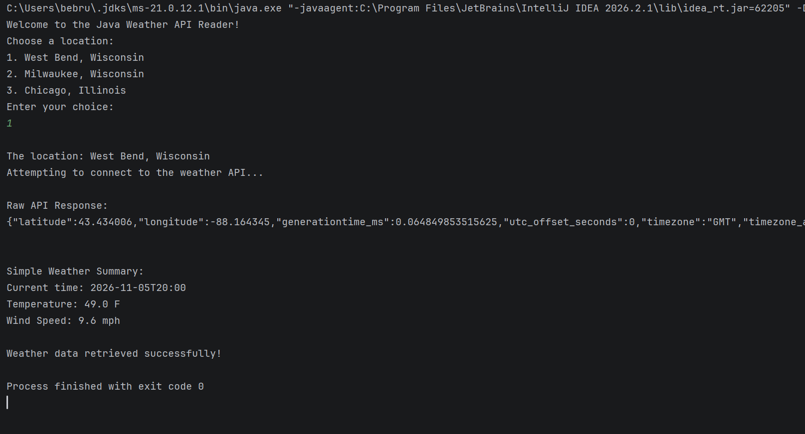

# WeatherAPIReader

## Weather Data API Reader

This Java console application connects to the Open-Meteo weather API to retrieve and display current weather information for a selected location.

## Features

- Choose between West Bend, Milwaukee, and Chicago
- Connect to the Open-Meteo weather API
- Retrieve weather information using a network request
- Display the raw JSON API response
- Display current temperature in Fahrenheit
- Display wind speed in mph
- Handle network errors using exception handling

## Technologies Used

- Java
- IntelliJ IDEA
- Open-Meteo Weather API
- JSON

## API

Open-Meteo Forecast API:
https://api.open-meteo.com/v1/forecast

## Screenshots

### Weather API Output

## How to Run

1. Open the WeatherAPIReader project in IntelliJ IDEA.
2. Run the main Java class.
3. Select a location by entering 1, 2, or 3.
4. The program connects to Open-Meteo and displays the weather information.
